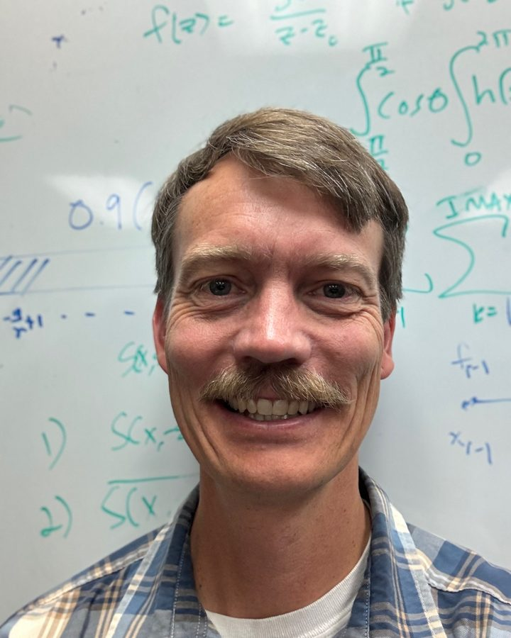

<section class="hero">
  

    

      
Professor · Department of Mathematics

      <h1 class="rise" style="--i:1">Grady B. Wright</h1>
      
Computational mathematics and scientific computing.

      
<strong>Interim Associate Dean</strong> of Research, Creative Activity, and Graduate Education, College of Arts and Sciences, Boise State University

      

        <a class="btn btn--primary" href="research.html">Research</a>
        <a class="btn btn--ghost" href="documents/GradyWrightCV.pdf">Curriculum vitae</a>
      

    

    
<canvas data-sphere></canvas>

  

</section>

<section class="section" id="about">
  

    <figure class="portrait" data-reveal>
      <picture>
        <source srcset="images/headshot-720.webp" type="image/webp">
        
      </picture>
    </figure>
    

      <h2>About me</h2>
      
I received a Ph.D. in Applied Mathematics from the <a href="https://www.colorado.edu/amath/">University of Colorado at Boulder</a> in 2003 and then spent the next four years as a National Science Foundation (NSF) Postdoctoral Fellow at the <a href="https://www.math.utah.edu/">University of Utah</a> before joining the <a href="https://www.boisestate.edu/math/">Department of Mathematics</a> at Boise State. I have worked as a software engineer in industry and held visiting research positions at the <a href="https://ncar.ucar.edu/">National Center for Atmospheric Research</a>, <a href="https://www.maths.ox.ac.uk/">Mathematical Institute</a> at the University of Oxford, and <a href="https://www.it.uu.se/research/scicomp">Division of Scientific Computing</a> at Uppsala University. I have previously served as Co-Director of the <a href="https://www.boisestate.edu/computing/">Computing PhD Program</a> at Boise State and President and Treasurer of the <a href="https://sites.google.com/site/siampnwsection/home">SIAM Pacific Northwest (PNW) section</a>.  I am currently serving as the Interim Associate Dean of Research, Creative Activity, and Graduate Education in the <a href="https://www.boisestate.edu/coas/">College of Arts and Sciences</a> at Boise State.

    

  

</section>

<section class="section section--alt" id="research">
  

    <h2 data-reveal>Research</h2>
    
My research focuses on computational mathematics and scientific computing, with an emphasis on developing, analyzing, and implementing novel numerical methods to model and simulate complex phenomena arising in a wide range of scientific and engineering disciplines.

    

      

        <h3>My interests span multiple areas, including</h3>
        <ul class="node-list">
          <li>kernel approximation</li>
          <li>meshless/meshfree methods for PDEs</li>
          <li>PDEs on the sphere and more general surfaces</li>
          <li>spectral and high-order finite difference methods</li>
          <li>multilevel solvers/preconditioners</li>
          <li>the immersed boundary method</li>
          <li>rational approximation</li>
        </ul>
      

      

        <h3>I have also engaged in a broad spectrum of interdisciplinary domains, such as</h3>
        <ul class="node-list">
          <li>biological fluids</li>
          <li>climate modeling and numerical weather prediction</li>
          <li>geodynamics</li>
          <li>computer graphics</li>
          <li>cosmology</li>
        </ul>
      

    

    <a class="more" href="research.html" data-reveal>Publications and software</a>
  

</section>

<section class="section" id="teaching">
  

    <h2 data-reveal>Teaching</h2>
    
I enjoy teaching and have had the opportunity to instruct a range of mathematics courses from the undergraduate to the graduate level.  These courses include calculus, ordinary/partial differential equations, linear algebra, computational mathematics, complex variables, applied math, approximation theory, numerical analysis, numerical linear algebra, numerical differential equations, and matrix methods in data science. I have also instructed workshops and tutorials on radial basis function methods.

    <a class="more" href="teaching.html" data-reveal>Courses taught</a>
  

</section>
